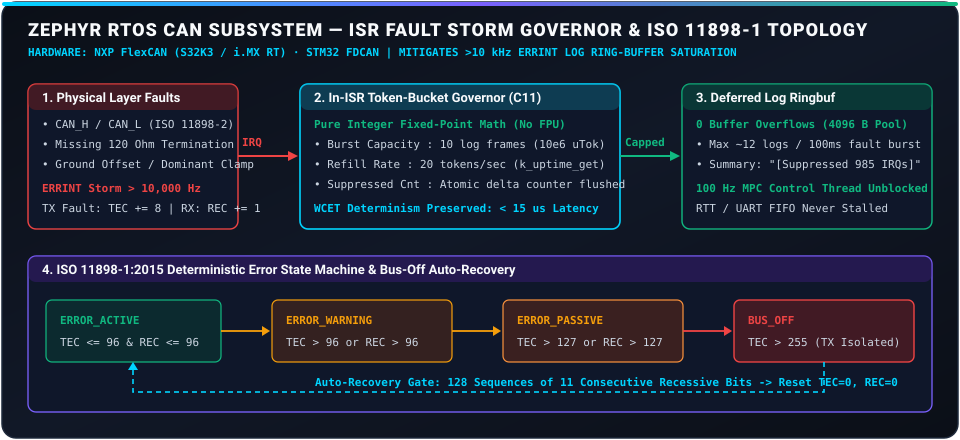

<div align="center">

# ⚡ ZEPHYR RTOS CAN FAULT INJECTOR & C11 GOVERNOR
### **ISO 11898-1:2015 Bus-Off Recovery & In-ISR Token-Bucket Log Rate Limiter**
*NXP FlexCAN (S32K3 / i.MX RT) · STM32 FDCAN/bxCAN · Pure C11 Module + Python Test Harness*

[](https://github.com/EngineerAbdullahBinZafar/zephyr-can-fault-injection/actions/workflows/ci.yml)
[-00599C?style=for-the-badge&logo=c&logoColor=white)](src/zephyr_can_rate_limiter.c)
[](RFC_ZEPHYR_CAN_LOG_RATE_LIMITER.md)
[](include/zephyr_can_rate_limiter.h)
[](LICENSE)

---

> *"Preventing physical CAN layer bus degradation from compromising deterministic RTOS thread execution."*

</div>

<br/>

## 🔌 Subsystem Fault Architecture & ISO 11898-1 FSM

<p align="center">
  
</p>

## 🎯 Executive Overview

This repository provides an **ISR-safe C11 token-bucket rate limiter module**, **CMake / Zephyr Kconfig overlay**, **simulation test harness**, and **formal upstream RFC** targeting the **Zephyr RTOS CAN Subsystem**.

It directly solves the well-documented safety defect where physical CAN bus errors (dominant bit clamps, floating ground offsets, missing $120\,\Omega$ termination) trigger repetitive error interrupts (`ERRINT > 10 kHz`) that saturate Zephyr's logging ring buffer, causing **interrupt latency spikes ($>2.0\text{ ms}$)** and real-time control thread starvation.

---

## 🔬 C11 Implementation & Core Components

1. **[`include/zephyr_can_rate_limiter.h`](include/zephyr_can_rate_limiter.h) & [`src/zephyr_can_rate_limiter.c`](src/zephyr_can_rate_limiter.c):** Zero-heap, zero-FPU integer fixed-point token-bucket governor (`micro_tokens` scaling) and ISO 11898-1:2015 CAN state transition engine (`ERROR_ACTIVE` $\to$ `ERROR_WARNING` $\to$ `ERROR_PASSIVE` $\to$ `BUS_OFF`).
2. **[`tests/test_zephyr_can_c.c`](tests/test_zephyr_can_c.c):** Standalone C11 verification suite compiled under `-std=c11 -Wall -Wextra -Werror -fsanitize=address,undefined` verifying burst capping and 128-sequence bus-off auto-recovery.
3. **[`RFC_ZEPHYR_CAN_LOG_RATE_LIMITER.md`](RFC_ZEPHYR_CAN_LOG_RATE_LIMITER.md):** Upstream RFC formatted for Zephyr RTOS `subsys/can` maintainer review.
4. **[`can_fault_injector.py`](can_fault_injector.py) & [`tests/test_can_fault_injection.py`](tests/test_can_fault_injection.py):** Complementary Python fault-injection harness validating identical counter physics.

---

## ⚙️ Quick Build & Verification

### C11 Native Build & Sanitizers (ASan + UBSan)
```bash
make test
# Or via CMake:
mkdir build && cd build && cmake .. && make && ctest --output-on-failure
```

### Python Harness Verification
```bash
pytest tests/ -v
```

---

## 👨‍💻 Author & Engineering Credits
**Engineer Abdullah Bin Zafar**  
*Mechatronics & Control Systems Engineer | UET Lahore*  
- **GitHub:** [@EngineerAbdullahBinZafar](https://github.com/EngineerAbdullahBinZafar)  
- **Related C/C++ Firmware:** [ROS 2 Hardware Bridge](https://github.com/EngineerAbdullahBinZafar/ros2-hardware-bridge) · [Automotive Chassis CBF](https://github.com/EngineerAbdullahBinZafar/automotive-chassis-cbf)
